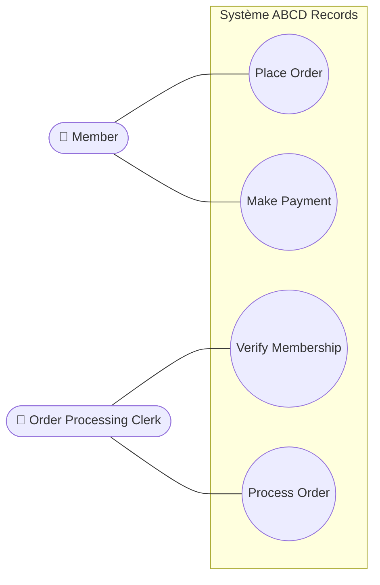
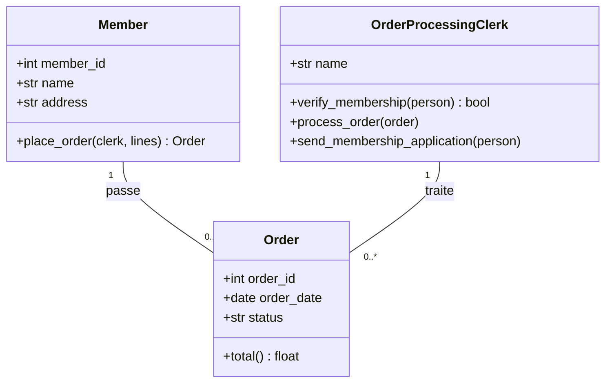
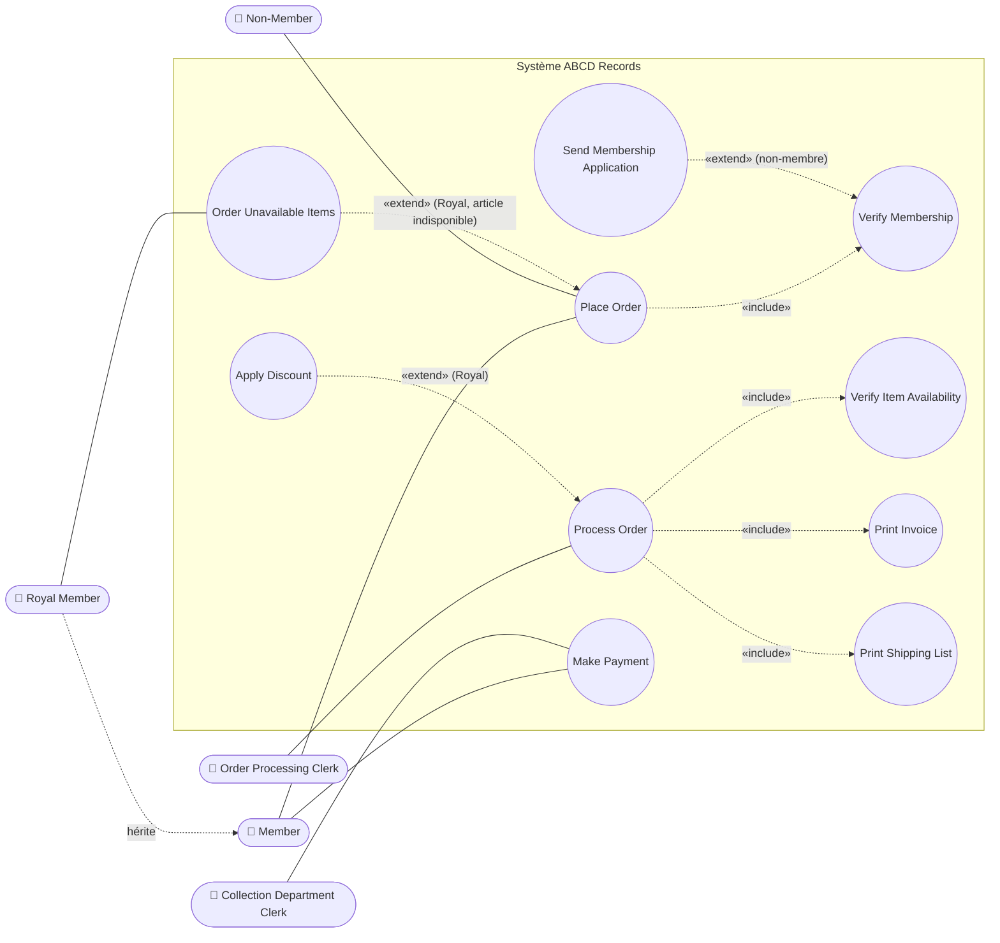
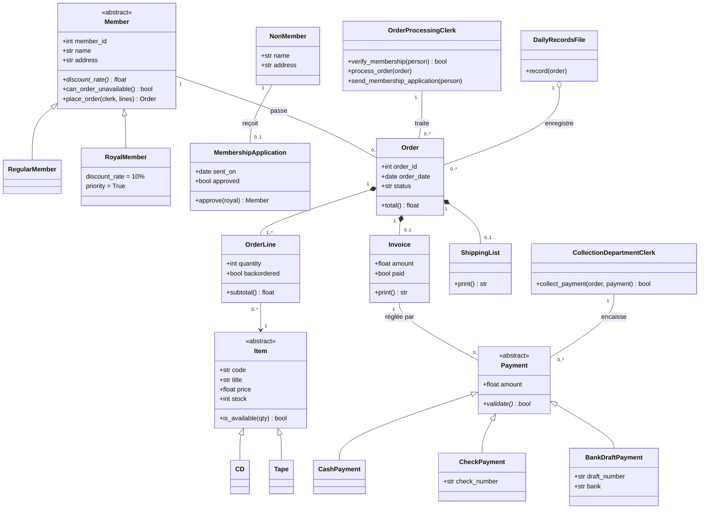
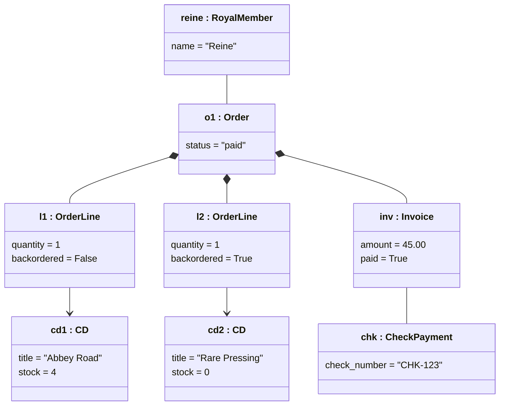
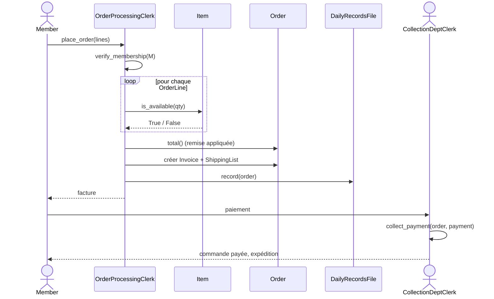
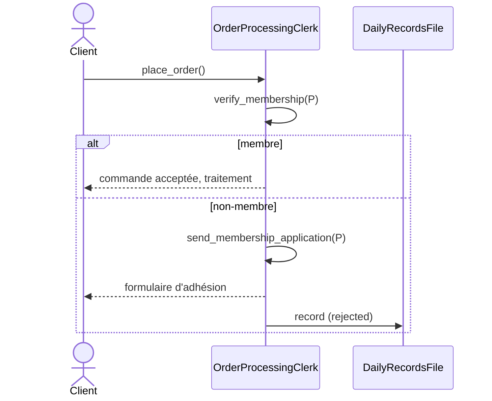
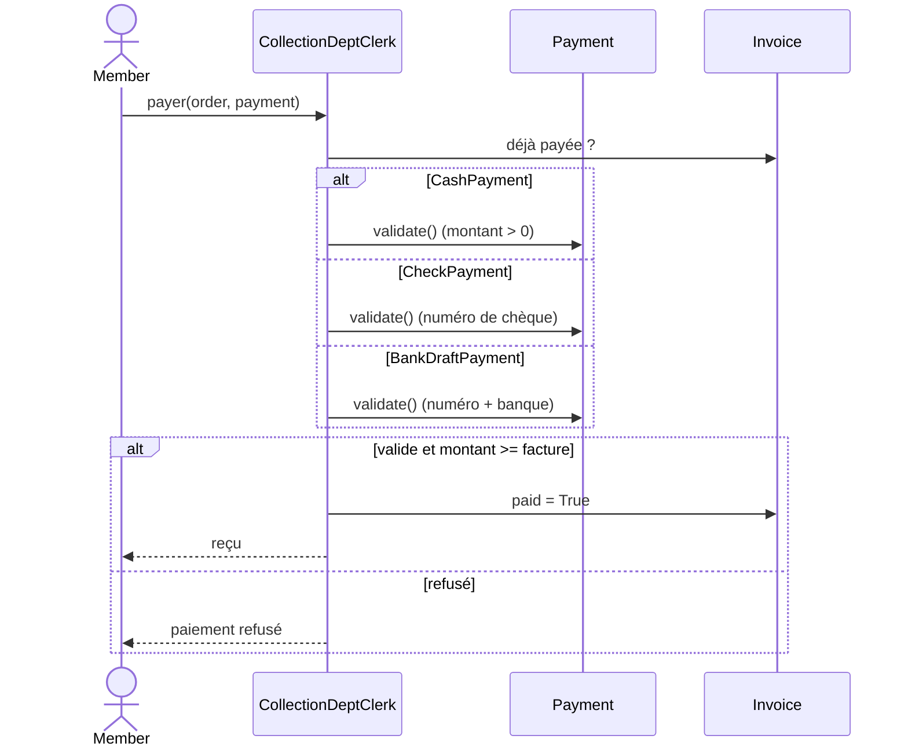
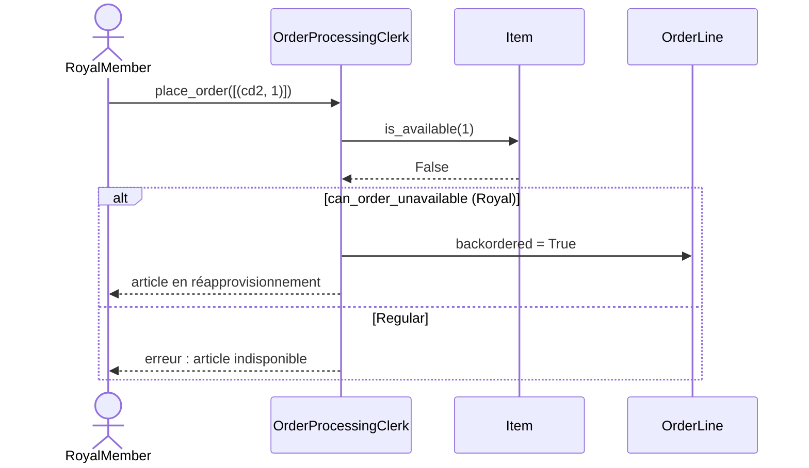

# Exo 2 – ABCD Records

Implémentation Python : [abcd_records.py](abcd_records.py)

> Mermaid n'a pas de diagramme de cas d'utilisation natif. On le représente avec un `flowchart` : les acteurs sont à l'extérieur du cadre « Système » et les cas d'utilisation sont des ovales à l'intérieur.

## Niveau 1

### Tâche 1.1 : cas d'utilisation (base)

### Tâche 1.2 : diagramme de classes (base)

## Niveau 2

### Tâche 2.1 : cas d'utilisation complets

### Tâche 2.2 : diagramme de classes complet

### Scénario : un membre Royal commande 2 CD (dont 1 indisponible) et paie par chèque

Diagramme d'objets (instances) :

## Niveau 3 : diagrammes de séquence

### Flux de commande complet

### Vérification d'adhésion (succès et échec)

### Traitement du paiement (tous types)

### Commande d'articles indisponibles (Royal uniquement)

