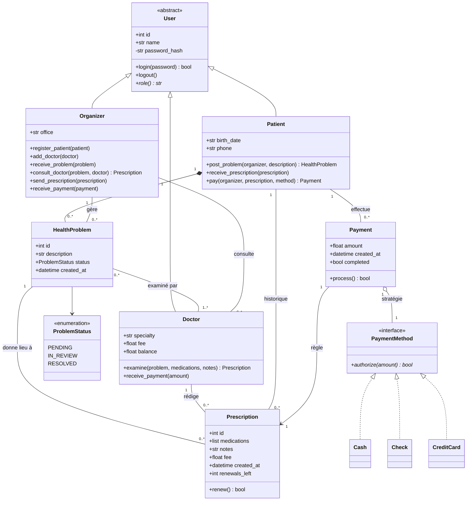
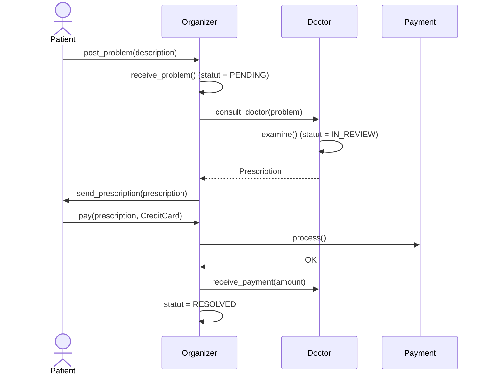
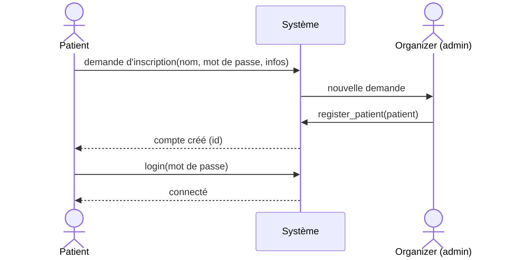
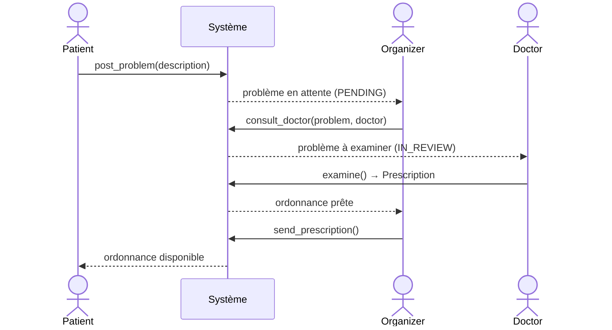
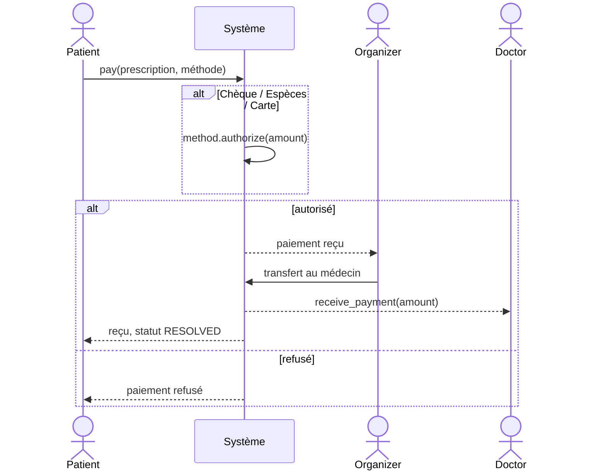

# Exo 1 – Système de gestion hospitalière

Implémentation Python : [hospital.py](hospital.py)

## Tâche 1 + 2 + 3 : diagramme de classes

## Tâche 2 : diagramme de séquence (un patient, de la soumission au paiement)

## Tâche 3 : diagrammes de séquence système

### Inscription d'un patient

### Consultation

### Paiement

## Questions

1. **Un patient qui consulte plusieurs médecins ?** L'association `HealthProblem "0..*" -- "1..*" Doctor` (liste `doctors` dans `HealthProblem`) permet à un même problème d'être examiné par plusieurs médecins, et chaque médecin produit sa propre `Prescription`. Un patient a donc 0..* problèmes et 0..* ordonnances, venant de médecins différents.
2. **Les ordonnances sont-elles réutilisables ?** Oui, pour un traitement chronique. On le modélise avec un attribut `renewals_left` et une méthode `renew()`. Chaque renouvellement peut aussi créer une nouvelle `Prescription` qui référence l'originale.
3. **Quel design pattern pour le paiement ?** Le pattern **Strategy** : `Payment` délègue à une `PaymentMethod` abstraite (`Cash`, `Check`, `CreditCard`). On peut ajouter un mode de paiement sans modifier `Payment` (principe ouvert/fermé). Un pattern Factory peut créer la bonne stratégie.
4. **Intégrité des données de paiement ?** Un paiement ne peut être traité qu'une fois (`completed`), le montant vient de l'ordonnance et non du client, on ne stocke que les 4 derniers chiffres de la carte, le mot de passe est haché, et on garde l'horodatage pour l'audit. En production, on ajouterait des transactions en base de données, du chiffrement (TLS) et la conformité PCI-DSS.
